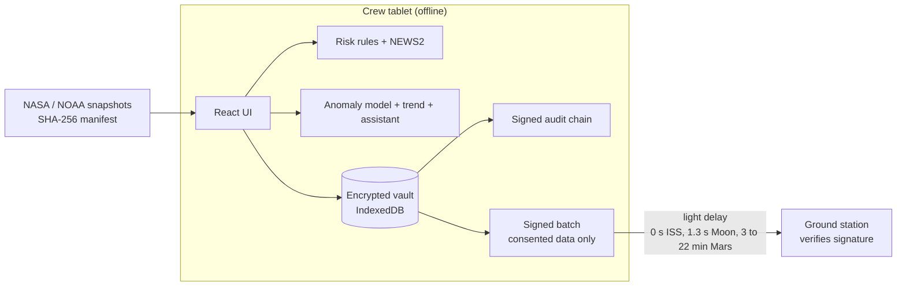

# AURORA

**English** | [Português](README.pt-BR.md)

Health monitoring for astronauts on long missions, built to keep working when Earth is 20 minutes
away and the crew medical officer is the one who is ill.

Built by team **Love Mode** for the NASA Space Apps Challenge 2026, challenge *Create Health
Monitoring Software for Astronauts on Space Missions*.

> **Simulated crew data.** The three crew members are fictional. Radiation and solar proton data
> are real NASA and NOAA measurements (sources below). AURORA is a prototype, not a medical device.

## What it does

On the ISS a flight surgeon is a call away. On the way to Mars the signal takes 3 to 22 minutes each
way, so the crew has to notice problems and act on their own. AURORA runs entirely on a tablet in
the cabin, with no connection, and does four things:

- **Watches each person against their own normal.** Vital signs are compared with that person's
  baseline from the first days of the mission, not with a population average. A rules engine (NEWS2,
  sustained deviations, sleep, exercise, hydration, CO2, radiation, symptoms) raises alerts that
  always say why and what to do, with the published source.
- **Tracks radiation with real data.** Career dose against the NASA 600 mSv limit, with a robust
  trend, next to what DOSTEL (ISS), CRaTER (lunar orbit) and Curiosity RAD (Mars) measured during the
  May 2024 solar storms.
- **Checks the crew, not only the sensors.** A daily check-in and the 3-minute PVT-B vigilance test,
  which picks up sleep loss before people notice it.
- **Helps anyone follow a procedure.** An offline assistant that answers only from AURORA's
  procedures and cited studies, and refuses to diagnose.

Everything is encrypted on the device. Nothing reaches the ground unless the astronaut allows that
category, and every batch is signed and checked on arrival.

## Try it

Live demo: *link added at release*. Create any 6 to 12 digit PIN (it stays on your device), then pick
a scenario. **Fever in the crew medical officer** and **Solar storm on Mars** show the most.

```bash
cd apps/web
npm ci
npm run dev          # http://localhost:5173
```

## How it works



| Part | Where | What |
|---|---|---|
| Web app | [`apps/web`](apps/web) | React 19, TypeScript strict, Vite, Zod. Runs as an installable offline app. |
| Data pipeline | [`data`](data) | Python. Downloads NASA OSDR RadLab, NOAA GOES and OSDR study metadata into versioned snapshots with a SHA-256 manifest. |
| Model | [`ml`](ml) | Python, scikit-learn. Trains the anomaly model and exports it as JSON that the app scores in TypeScript. |

## AI that is free and runs on board

No language model, no cloud API, no cost per use. Three small methods, each one explainable:

- **Isolation Forest** over deviations from the person's own baseline. Trained in Python, exported
  to JSON, scored in the browser with the same result as scikit-learn (checked by parity vectors).
  A day is flagged only when 2 or more of its 4 readings are unusual. On held-out simulated data:
  0% of healthy days flagged, 100% of days with strong changes caught, and lower recall on mild
  changes, which the [model card](docs/model-card.md) reports case by case.
- **Theil-Sen trend** for the career dose forecast: one storm day cannot tilt the projection.
- **BM25 retrieval** for the assistant. It assembles answers from verified passages only, so it
  cannot invent facts, and user text is only ever a search query, never an instruction.

The model card also documents a mistake: the first version was calibrated on a single baseline per
person and raised false alarms on healthy crew. It was retrained on 50 baselines per person.

## Security

Threat model in [docs/threat-model.md](docs/threat-model.md). In short:

- **Encryption at rest.** AES-GCM 256 with a key derived from the PIN (PBKDF2-SHA256, 600,000
  iterations, OWASP 2023). Each record is bound to its collection and id as associated data, so
  records cannot be swapped. The key only lives in memory; a reload or 5 idle minutes lock the app.
- **Brute force.** Five free attempts, then an exponential lockout up to 30 minutes, stored with the
  vault.
- **Integrity.** Audit entries are hash-chained and signed with ECDSA P-256. Data snapshots are
  rejected if their SHA-256 or schema does not match, and the model if its structure is invalid. Batches to the ground are signed and
  verified; a batch altered in transit is discarded.
- **Browser hardening.** CSP with no inline script or eval and Trusted Types enforced, HSTS,
  COOP/COEP/CORP, no referrer, a Permissions-Policy that turns off camera, microphone and location.
- **Supply chain.** Exact dependency versions, lockfiles, installs without lifecycle scripts, CI
  actions pinned by commit SHA, Dependabot with a 7-day cooldown, CodeQL, gitleaks and OSV-Scanner.

Found a problem? See [SECURITY.md](SECURITY.md).

## Tests

```bash
cd apps/web
npm run lint && npm run typecheck
npm test                 # unit and component tests
npm run test:coverage
npm run test:e2e         # Chromium, against the production build and its real headers
```

| Suite | Count | Notes |
|---|---|---|
| Web unit and component | 290 | real WebCrypto and IndexedDB; 97% line coverage including the UI |
| Web end to end | 8 | full mission day with WCAG 2.2 AA checks on every screen, offline use, CSP, tampered data |
| Data pipeline | 40 | 99% coverage; checks the May 2024 storm in the snapshots |
| Model | 9 | false alarms, recall, no data leaking between splits |

## Data sources

| Data | Source | License |
|---|---|---|
| Absorbed dose, May 2024 | [NASA OSDR RadLab](https://visualization.osdr.nasa.gov/radlab/) (DOSTEL, CRaTER, MSL-RAD) | NASA open data, public domain |
| Solar protons | [NOAA SWPC GOES](https://services.swpc.noaa.gov/json/goes/primary/integral-protons-1-day.json) | US government work, public domain |
| Study metadata | [NASA OSDR](https://osdr.nasa.gov/bio/) | NASA open data, public domain |

Retrieval dates and checksums are in [`apps/web/public/data/manifest.json`](apps/web/public/data/manifest.json).
Every threshold and procedure cites its study in [`evidence.ts`](apps/web/src/domain/evidence.ts).
More in the [data card](docs/data-card.md).

## Limitations

- Not a medical device and not validated with real astronauts. The crew is simulated.
- The anomaly model was trained on simulated people. Real use would need retraining on real
  baselines and clinical review.
- The ground station runs in the browser to show the protocol; there is no server.
- PBKDF2 is used because it is what WebCrypto offers natively. Argon2id would resist GPU attacks
  better but needs extra code in the browser.
- There is no PIN recovery, by design: the key never leaves the device.

## Team

Team **Love Mode**: Fabrício Júnio and Camila Pereira Raimundo.

## Use of AI

This project was built with the support of generative AI tools. Modelling, business rules, code
review and conclusions were reviewed and validated by the team.

## License

[Apache License 2.0](LICENSE).
