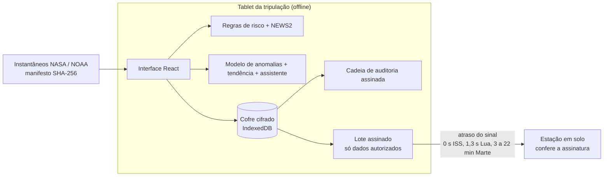

# AURORA

[English](README.md) | **Português**

Monitoramento de saúde para astronautas em missões longas, feito para continuar funcionando quando a
Terra está a 20 minutos de distância e o oficial médico da tripulação é quem está doente.

Desenvolvido pela equipe **Love Mode** para o NASA Space Apps Challenge 2026, desafio *Create Health
Monitoring Software for Astronauts on Space Missions*.

> **Dados simulados da tripulação.** Os três tripulantes são fictícios. Os dados de radiação e de
> prótons solares são medições reais da NASA e da NOAA (fontes abaixo). O AURORA é um protótipo, não
> um dispositivo médico.

## O que ele faz

Na ISS, o médico de voo está a uma ligação de distância. A caminho de Marte, o sinal leva de 3 a 22
minutos em cada sentido, e a tripulação precisa perceber os problemas e agir sozinha. O AURORA roda
inteiro num tablet na cabine, sem conexão, e faz quatro coisas:

- **Compara cada pessoa com o próprio normal.** Os sinais vitais são comparados com a linha de base
  daquela pessoa nos primeiros dias da missão, não com uma média da população. Um motor de regras
  (NEWS2, desvios persistentes, sono, exercício, hidratação, CO2, radiação, sintomas) gera alertas
  que sempre dizem o porquê e o que fazer, com a fonte publicada.
- **Acompanha a radiação com dados reais.** A dose de carreira contra o limite de 600 mSv da NASA,
  com uma tendência robusta, ao lado do que a DOSTEL (ISS), a CRaTER (órbita lunar) e o RAD da
  Curiosity (Marte) mediram durante as tempestades solares de maio de 2024.
- **Avalia a tripulação, não só os sensores.** Um check-in diário e o teste de vigilância PVT-B de
  3 minutos, que detecta a perda de sono antes de a pessoa perceber.
- **Ajuda qualquer um a seguir um procedimento.** Um assistente offline que responde só com os
  procedimentos e estudos citados do AURORA, e se recusa a diagnosticar.

Tudo fica cifrado no dispositivo. Nada chega à Terra sem que o astronauta autorize aquela categoria,
e cada lote é assinado e conferido na chegada.

## Como testar

Demonstração online: **https://aurora-astronaut-health.vercel.app**. Crie qualquer PIN de 6 a 12 dígitos (ele fica
só no seu dispositivo) e escolha um cenário. **Fever in the crew medical officer** e **Solar storm on
Mars** são os que mais mostram.

```bash
cd apps/web
npm ci
npm run dev          # http://localhost:5173
```

## Como funciona



| Parte | Onde | O quê |
|---|---|---|
| Aplicativo web | [`apps/web`](apps/web) | React 19, TypeScript estrito, Vite, Zod. Roda como aplicativo instalável e offline. |
| Pipeline de dados | [`data`](data) | Python. Baixa NASA OSDR RadLab, NOAA GOES e metadados de estudos da OSDR em instantâneos versionados, com manifesto SHA-256. |
| Modelo | [`ml`](ml) | Python, scikit-learn. Treina o modelo de anomalias e o exporta em JSON, que o aplicativo avalia em TypeScript. |

## IA gratuita e que roda a bordo

Sem modelo de linguagem, sem API na nuvem, sem custo por uso. São três métodos pequenos, todos
explicáveis:

- **Isolation Forest** sobre os desvios em relação à linha de base da própria pessoa. Treinado em
  Python, exportado em JSON e avaliado no navegador com o mesmo resultado do scikit-learn (conferido
  por vetores de paridade). Um dia só é marcado quando 2 ou mais das suas 4 leituras são incomuns.
  Em dados simulados separados para teste: 0% dos dias saudáveis marcados, 100% dos dias com
  alterações fortes detectados e detecção menor nas alterações leves, que o
  [model card](docs/model-card.md) detalha caso a caso.
- **Tendência por Theil-Sen** na previsão da dose de carreira: um único dia de tempestade não
  entorta a projeção.
- **Busca BM25** no assistente. Ele monta as respostas só com trechos verificados, então não tem como
  inventar fatos, e o texto do usuário é sempre só uma consulta de busca, nunca uma instrução.

O model card também registra um erro: a primeira versão foi calibrada com uma única linha de base por
pessoa e gerava falsos alarmes em tripulantes saudáveis. O modelo foi retreinado com 50 linhas de
base por pessoa.

## Segurança

O modelo de ameaças está em [docs/threat-model.md](docs/threat-model.md). Em resumo:

- **Cifragem em repouso.** AES-GCM de 256 bits com chave derivada do PIN (PBKDF2-SHA256, 600.000
  iterações, OWASP 2023). Cada registro fica amarrado à sua coleção e ao seu identificador como dado
  associado, então registros não podem ser trocados de lugar. A chave existe só na memória; recarregar
  a página ou ficar 5 minutos sem uso trava o aplicativo.
- **Força bruta.** Cinco tentativas livres e, depois, bloqueio exponencial de até 30 minutos, gravado
  junto com o cofre.
- **Integridade.** As entradas de auditoria são encadeadas por hash e assinadas com ECDSA P-256. Os
  instantâneos de dados são rejeitados se o SHA-256 ou o esquema não baterem, e o modelo se a
  estrutura for inválida. Os lotes enviados à Terra são assinados e conferidos; um lote alterado no
  caminho é descartado.
- **Proteção do navegador.** CSP sem script inline nem eval e com Trusted Types obrigatório, HSTS,
  COOP/COEP/CORP, sem referrer e uma Permissions-Policy que desliga câmera, microfone e localização.
- **Cadeia de suprimentos.** Versões exatas das dependências, lockfiles (com hash no Python),
  instalação sem scripts, actions do CI fixadas pelo SHA do commit, Dependabot com 7 dias de espera,
  CodeQL, gitleaks e OSV-Scanner.

Encontrou um problema? Veja [SECURITY.md](SECURITY.md).

## Testes

```bash
cd apps/web
npm run lint && npm run typecheck
npm test                 # testes unitários e de componentes
npm run test:coverage
npm run test:e2e         # Chromium, contra o build de produção e seus cabeçalhos reais
```

| Conjunto | Quantidade | Observações |
|---|---|---|
| Web, unitários e de componentes | 290 | WebCrypto e IndexedDB reais; 97% de cobertura de linhas, incluindo a interface |
| Web, ponta a ponta | 8 | dia completo de missão com checagem WCAG 2.2 AA em cada tela, uso offline, CSP, dados adulterados |
| Pipeline de dados | 40 | 99% de cobertura; confere a tempestade de maio de 2024 nos instantâneos |
| Modelo | 9 | falsos alarmes, detecção, nenhum vazamento de dados entre as divisões |

## Fontes de dados

| Dado | Fonte | Licença |
|---|---|---|
| Dose absorvida, maio de 2024 | [NASA OSDR RadLab](https://visualization.osdr.nasa.gov/radlab/) (DOSTEL, CRaTER, MSL-RAD) | dados abertos da NASA, domínio público |
| Prótons solares | [NOAA SWPC GOES](https://services.swpc.noaa.gov/json/goes/primary/integral-protons-1-day.json) | obra do governo dos EUA, domínio público |
| Metadados de estudos | [NASA OSDR](https://osdr.nasa.gov/bio/) | dados abertos da NASA, domínio público |

As datas de coleta e os checksums estão em
[`apps/web/public/data/manifest.json`](apps/web/public/data/manifest.json). Cada limite e
procedimento cita o seu estudo em [`evidence.ts`](apps/web/src/domain/evidence.ts). Mais detalhes no
[data card](docs/data-card.md).

## Limitações

- Não é um dispositivo médico e não foi validado com astronautas reais. A tripulação é simulada.
- O modelo de anomalias foi treinado com pessoas simuladas. O uso real exigiria retreinar com linhas
  de base reais e revisão clínica.
- A estação em solo roda no navegador para demonstrar o protocolo; não há servidor.
- O PBKDF2 é usado porque é o que o WebCrypto oferece nativamente. O Argon2id resistiria melhor a
  ataques com GPU, mas exigiria código extra no navegador.
- Não há recuperação de PIN, de propósito: a chave nunca sai do dispositivo.

## Equipe

Equipe **Love Mode**: Fabrício Júnio e Camila Pereira Raimundo.

## Uso de IA

Este projeto foi estruturado com apoio de ferramentas de IA generativa. Modelagem, regras de negócio,
revisão do código e conclusões foram revisadas e validadas pela equipe.

## Licença

[Apache License 2.0](LICENSE).
